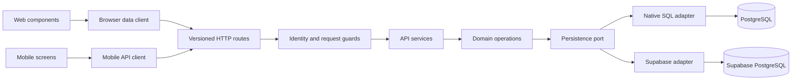

# Learn software development through VSIS Timesheet

> **Update (2026-10-16):** The Supabase backend and the `NEXT_PUBLIC_BACKEND` switch were removed; native PostgreSQL with in-app auth is the only backend. References below to Supabase mode, Supabase adapters/RLS or the dual-backend design describe the previous architecture.

Prepared on 2026-10-08 from working-tree source at commit `0fc5f63f03116a3b79153fddbe0ac055001af076`. This includes pre-existing uncommitted release changes. Versions describe this checkout, not every deployed environment.

## Your starting point

You already understand systems engineering, cloud infrastructure, Kubernetes, DevOps, and solution architecture. The learning goal is to independently read, debug, modify, extend, and eventually design applications like this one. Application-language proficiency has not yet been assessed.

We will connect familiar infrastructure concepts to application code where the analogy helps, then explain the differences. For example, an application permission check resembles an authorization policy, but a React component is a function that describes UI, not a running service.

**Lesson 1 has not started.** Say `Start Lesson 1` when ready. Reading these reference materials does not count as demonstrating understanding.

## What the project contains

VSIS Timesheet has a Next.js web application and a separate React Native client for Android, iOS, and Windows. Features include time entry, project/activity classification, leave, reminders, reporting, profiles, and administration.

Both clients share calculations, request/response contracts, and HTTP-client logic. The server supports two backend modes selected by `NEXT_PUBLIC_BACKEND`:

| Mode | Authentication | Persistence | Deployment examples in the repository |
| --- | --- | --- | --- |
| `supabase` (default) | Supabase Auth | PostgreSQL through Supabase clients, PostgREST, RLS, and RPCs | Vercel; a Supabase-mode OpenShift image also exists |
| `native` | Application password hashing and signed sessions | PostgreSQL through `pg` and explicit SQL | Standalone Node server, Docker, Kubernetes/OpenShift |

Evidence: [backend resolution](../../lib/backend/config.ts) lines 9–21, [server authentication](../../lib/auth/index.ts), [timesheet composition](../../lib/db/timesheets.ts), [Dockerfile](../../Dockerfile), [Next configuration](../../next.config.ts), and [OpenShift Supabase image](../../deploy/openshift/Dockerfile.supabase).

## Start with this mental model

A **port** is an interface describing operations an application needs. An **adapter** implements those operations for a particular technology. This is the same problem as defining a provider-neutral infrastructure interface, implemented for different clouds. The runtime still executes ordinary function calls.

This diagram describes interactive data calls. Initial dashboard rendering takes a server-side path directly into domain services; it does not call its own HTTP API. Supabase browser sign-in uses the provider SDK. Retained Server Actions and old routes provide compatibility surfaces. See [execution flows](05-code-execution-flows.md).

## Reading order

| Guide | Purpose |
| --- | --- |
| [01 — Technology stack](01-technology-stack.md) | Languages, exact checkout versions, libraries, tools, build and deployment |
| [02 — Language roadmap](02-programming-language-roadmap.md) | Levels 1–2: JavaScript and TypeScript foundations |
| [03 — Framework and engineering roadmap](03-framework-roadmap.md) | Levels 3–6: React, Next.js, application development and production concerns |
| [04 — Architecture walkthrough](04-architecture-walkthrough.md) | Directories, layers, persistence, patterns and trade-offs |
| [05 — Execution flows](05-code-execution-flows.md) | Startup, dashboard rendering, save, sign-in and mobile replay |
| [06 — Concepts and examples](06-key-concepts-and-examples.md) | Small actual source excerpts to revisit during lessons |
| [07 — Practical exercises](07-practical-exercises.md) | Read-only work first, followed by explicitly authorized coding |
| [08 — Learning progress](08-learning-progress.md) | Evidence-based learner record |
| [09 — Technical glossary](09-technical-glossary.md) | Terms used in the lessons |

## Evidence and limits

- **Verified:** Selected current source, manifests, lockfile entries, installed package versions, route/service/domain/adapter bodies, relevant migrations, testing configuration, and deployment definitions were inspected.
- **Inference:** Explanations of architectural benefits are reasoned interpretations unless a source comment states the intent. A design benefit does not establish the original author's motivation.
- **Unknown:** Active deployment mode, production configuration, applied migration versions, live database contents, running service behavior, and your demonstrated proficiency. No deployment or database was contacted for this analysis.
- Atlas was attempted and returned `permission denied reading .`. Serena supplied current symbols and references. The knowledge graph metadata points to `55545e77b7b655b0f72e0b5d889ee61ada6d87e7`, a resolvable older commit with substantial source drift; graph summaries were not used to establish current behavior.
- Existing architecture notes contain older version numbers and some retired repository-facade terminology. Current source takes precedence. This learning task does not refresh the graph or architecture baseline.
- This is a source-based analysis, not an exhaustive security audit or a claim that the application passes its full test matrix. Teaching examples should be checked against current source before reuse.

## First lesson recommendation

**Lesson 1: values, variables, comparisons, and functions.** Use the small `requiresProject` function in [timesheet contracts](../../packages/contracts/src/timesheets.ts), lines 75–77. Its lack of HTTP or database dependencies lets us learn what a function receives, evaluates, and returns before adding framework behavior. The lesson will introduce a tiny standalone example, explain this source excerpt, and end with a read-only exercise and 2–3 questions.

No application files may be changed as part of tutoring without your explicit permission. The learning guides and progress record are the persistent teaching materials.

## Use the tutor in future sessions

The repository-local [codebase-tutor skill](../../.agents/skills/codebase-tutor/SKILL.md) supports `$codebase-tutor` followed by `Teach me`, `Explain this file`, `Trace this feature`, `Explain this code`, `Why this approach?`, `Give me an exercise`, `Quiz me`, or `My progress`. Natural-language equivalents also work. The skill reads the progress record and verifies the relevant current source before teaching.

The repository currently ignores `.agents/` in `.gitignore`. The skill exists locally and is validated, but an ordinary Git commit will not include it. Sharing it through Git requires deliberately changing that tracking policy or explicitly adding this file. This setup preserves the existing ignore/index settings.
