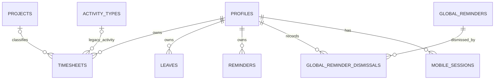

# Architecture walkthrough

Use this as a navigation guide, then verify the current source before a lesson or change. The architecture notes under [docs/ai-context](../ai-context/README.md) remain useful, but some references describe earlier versions of the code.

## Directory responsibilities

| Location | Responsibility | First useful anchor |
| --- | --- | --- |
| `app/` | Next route UI, layouts, HTTP handlers, interactive web features | [root layout](../../app/layout.tsx), [dashboard page](../../app/dashboard/page.tsx) |
| `app/components/` | Shared controls, dialogs, charts, themes and notifications | [UI](../../app/components/ui.tsx); there is no `components/ui/` directory convention here |
| `app/dashboard/` | Feature forms, tables, reporting/admin panels and browser composition | [time-entry form](../../app/dashboard/time-entry-form.tsx), [dashboard client](../../app/dashboard/dashboard-client.tsx) |
| `app/api/v1/` | Versioned API for mobile and explicitly opted-in web cookie callers | [guard](../../app/api/v1/_http.ts), [timesheets route](../../app/api/v1/timesheets/route.ts) |
| `app/api/auth/`, `app/api/data/`, `app/actions/` | Retained legacy/compatibility paths; verify each caller before assuming it is primary | [Server Action entry](../../app/actions.ts), [legacy login](../../app/api/auth/login/route.ts) |
| `lib/api/v1/` | HTTP-oriented services and DTO mapping | [timesheet service](../../lib/api/v1/services/timesheets.ts), [mapping](../../lib/api/v1/contracts.ts) |
| `lib/domain/` | Application operations/rules and narrow persistence interfaces | [timesheets](../../lib/domain/timesheets.ts), [port](../../lib/domain/timesheets-port.ts) |
| `lib/db/` | Domain composition modules, shared actor/results, pool, DB migration wrapper | [composition](../../lib/db/timesheets.ts), [types](../../lib/db/types.ts), [pool](../../lib/db/pool.ts) |
| `lib/db/native/`, `lib/db/supabase/` | Matching provider adapters for timesheets, reference data, people, workspace, operations, leave/reminders and reporting | [native create](../../lib/db/native/timesheets.ts), [Supabase create](../../lib/db/supabase/timesheets.ts) |
| `lib/auth/` | Server/browser facades and backend-specific identity/session/password behavior | [server facade](../../lib/auth/index.ts), [browser facade](../../lib/auth/client.ts) |
| `lib/data/` | Browser data facade over versioned HTTP | [data client](../../lib/data/client.ts) |
| `packages/core/` | Pure shared calculations and helpers | [smart hours](../../packages/core/src/smart-hours.ts) |
| `packages/contracts/` | Shared schemas, DTOs, classifications and result envelopes | [timesheets](../../packages/contracts/src/timesheets.ts), [API envelope](../../packages/contracts/src/api-result.ts) |
| `packages/client/` | Shared typed HTTP transport/client logic | [client core](../../packages/client/src/api-client.ts) |
| `db/`, `supabase/` | Native and provider migration histories, setup/seed definitions | [native schema](../../db/migrations/0001_initial_schema.sql), [Supabase migrations](../../supabase/migrations/) |
| `mobile/` | Separate React Native application, native hosts and platform workflows | [app](../../mobile/App.tsx), [API wrapper](../../mobile/src/api/client.ts) |
| `migrations/tool/` | Private operator-only cross-provider migration workspace | [manifest](../../migrations/tool/package.json), [entry](../../migrations/tool/src/cli-entry.ts) |
| `tests/`, `e2e/`, `load/` | Unit/integration, browser/accessibility and k6 workloads | [unit config](../../vitest.config.mts), [browser config](../../playwright.config.ts) |
| `deploy/`, `.github/workflows/`, `scripts/` | Deployment definitions, CI and maintenance/build utilities | [deployment](../../deploy/deployment.yaml), [CI](../../.github/workflows/ci.yml) |

## Follow the responsibility boundaries

For a timesheet save, the form collects strings and selections. Browser validation improves feedback. The data client serializes a request. The HTTP route authenticates the caller, parses the schema, and applies idempotency handling. An API service translates between transport and domain outcomes. The domain operation checks business rules. A persistence adapter implements database access. The database supplies final integrity constraints.

These layers address different failure modes. A “24 hours maximum” message in a form cannot prevent a crafted request or two simultaneous writes. Domain checks provide business feedback; database constraints and locking protect committed data.

The dependency graph also matters: `@vsis/client` depends on `@vsis/contracts`, which depends on `@vsis/core`. Shared calculations do not need the web framework or mobile UI. The operator migration workspace is deliberately outside the application's runtime dependency boundary.

## Persistence and schema

This project uses PostgreSQL in both modes. Native access uses `pg`; Supabase access uses provider clients/PostgREST/RPCs. There is no global repository dispatcher in the current timesheet composition; [timesheetDeps](../../lib/db/timesheets.ts) directly selects a narrow adapter and supplies a clock and write budget.

| Entity family | Relationships and purpose | Evidence |
| --- | --- | --- |
| Profiles and hierarchy | Application identity, active account, permission/hierarchy roles, management relationships | [initial schema](../../db/migrations/0001_initial_schema.sql), [separate roles](../../db/migrations/0009_separate_roles.sql), [DB types](../../lib/db/types.ts) |
| Timesheets, projects, activity types | A timesheet belongs to a user; historical rows use legacy project/activity fields; new classified entries may omit a project | [initial schema](../../db/migrations/0001_initial_schema.sql), [features](../../db/migrations/0002_features.sql), [classification](../../db/migrations/0039_timesheet_classification.sql) |
| Leaves and reminders | User-linked leave/reminder records; global reminders have per-user dismissal records | [initial schema](../../db/migrations/0001_initial_schema.sql), [features](../../db/migrations/0002_features.sql), [global banner](../../db/migrations/0041_global_reminder_banner.sql) |
| Workspace/reference state | Shared settings, titles, domain admission and audit records | [settings/reference port consumers](../../lib/domain/workspace.ts), [people](../../lib/domain/people.ts), [reference](../../lib/domain/reference.ts) |
| Session/recovery state | Persisted mobile-session lifecycle; native password-reset tokens | [mobile sessions](../../db/migrations/0017_mobile_sessions.sql), [password recovery](../../db/migrations/0023_password_recovery.sql) |
| Rate limits and retry state | Persistent budgets, idempotency keys/effects, imported-history compatibility | [rate limits](../../db/migrations/0024_rate_limits.sql), [idempotency](../../lib/idempotency.ts), [portable retry](../../lib/idempotency/portable-retry.ts) |

This is a selected relationship diagram, not an exhaustive schema. Project/activity references are optional at the table level after later migrations; entry-classification checks further constrain valid combinations. Native migration `0039` and Supabase migration `20261007000000` introduce `entry_type`, `activity_code`, `activity_other`, and `ticket_number` and allow nullable `project_id`. Historical rows retain legacy representation. The initial schema's original `NOT NULL` is therefore insufficient to describe today's schema.

Native migrations are managed by [the canonical runner](../../db/migrate-runner.mjs), shared by [the TypeScript wrapper](../../lib/db/migrate.ts) and seeding. [Pool queries](../../lib/db/pool.ts), lines 61–95, wait for cached migration initialization before DB access. This is lazy query-path initialization, not a claim that `instrumentation.register` opens a DB at process startup.

Applied migration files are immutable. Cross-backend changes need corresponding provider behavior and migration histories. Migration filenames, including future-dated ones, do not prove deployment/application state.

## Identity and authorization

[Server authentication](../../lib/auth/index.ts) resolves a session user and an **actor**: current identity plus application role/active-state information. Native authentication uses scrypt and signed cookies; Supabase authentication resolves provider identity plus current profile state. Browser callers use [authClient](../../lib/auth/client.ts), which selects backend-specific behavior.

Profiles have independent permission and hierarchy axes. `permission_role` determines kinds of action; `hierarchy_role` represents organizational scope. Do not reduce those to a single “admin versus user” test.

Versioned routes use [withMobileActor](../../app/api/v1/_http.ts). The historical name does not mean every caller is mobile. Bearer validation checks token, stored session and actor state; routes must explicitly allow browser cookies. Cookie mutations also pass an origin check. Native adapters enforce actor/resource scope through checks and parameterized SQL. Supabase adapters combine actor checks with RLS and RPC policies. A service-role read is not interchangeable with an RLS-scoped user read.

## Design patterns illustrated by this code

| Pattern | Actual example | Benefit and trade-off (inferred unless source states intent) |
| --- | --- | --- |
| Ports and adapters | [TimesheetPersistence](../../lib/domain/timesheets-port.ts), two adapters | Reuses rules across providers; requires parity checks and more navigation |
| Dependency injection | [timesheetDeps](../../lib/db/timesheets.ts), domain receives clock/persistence/budget | Enables focused tests and explicit dependencies; composition must remain correct |
| Facade | [authClient](../../lib/auth/client.ts), [dataClient](../../lib/data/client.ts) | Gives UI a consistent API; readers must trace facade behavior to understand provider differences |
| Pure calculation | [computeSmartHours](../../packages/core/src/smart-hours.ts) | Testable without network/framework; caller supplies and normalizes data |
| Result union / error boundary | [ApiResult](../../packages/contracts/src/api-result.ts), domain results, DbWrite | Explicit caller branches; mapping between layers adds responsibility |
| Single-flight / shared initialization | [browser reads](../../lib/data/client.ts), [ensureMigrated](../../lib/db/pool.ts) | Coalesces concurrent work; failure/retry lifecycle must be handled |
| Transaction and DB invariant | [native transaction helper](../../lib/db/pool.ts), [daily-hours trigger](../../db/migrations/0015_data_integrity_and_concurrency.sql) | Protects committed data under concurrency; lock behavior requires integration evidence |
| Durable idempotency and offline queue | [server retry wrapper](../../lib/idempotency.ts), [mobile engine](../../mobile/src/sync/sync-engine.ts) | Handles repeated logical operations; recovery/state transitions are complex |
| Shared contract package | [contracts](../../packages/contracts/src/index.ts), server mapper, web/mobile consumers | Reduces shape drift; a public-shape change has multiple consumers |

These are explanations of code organization, not reasons to add abstractions to every small function. Later lessons will compare direct calls, framework-only handlers, and adapter-based designs using concrete maintenance and testing costs.
