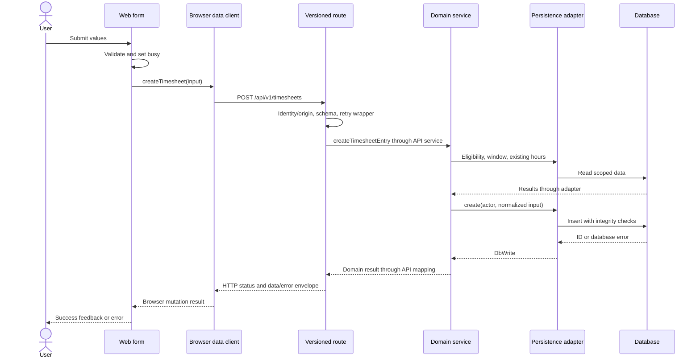

# Code execution flows

All flows below describe inspected source. No browser/server/database execution was performed for this analysis. Symbols and line numbers are snapshot anchors; verify them in future lessons.

## 1. Build and server startup

1. `npm run build` executes the prebuild auth-configuration script, `next build`, and postbuild asset copying from [package scripts](../../package.json).
2. [Next configuration](../../next.config.ts) transpiles shared TypeScript packages and enables standalone output outside Vercel. Public backend configuration is consumed during build.
3. In the native image, [Dockerfile](../../Dockerfile) starts the packaged standalone server with `node server.js`. `npm start` in a normal checkout instead calls `next start`; those are distinct entry points.
4. Next invokes [instrumentation.register](../../instrumentation.ts), lines 4 onward. In the Node runtime outside the build phase, it validates proxy/IP configuration. Invalid required configuration throws; mobile-bearer misconfiguration produces a startup warning, while request paths enforce access.
5. Native DB access initializes lazily. [query](../../lib/db/pool.ts), lines 83–95, awaits `ensureMigrated`, which caches a Promise from the canonical runner. Concurrent callers share this initialization; failure clears the cached state so a later attempt can retry. Pool construction itself is in `getPool`.

**Teaching point:** Startup hooks, module evaluation, build execution and the first database query are different moments. A comment claiming “startup migration” should be checked against the actual call path.

## 2. Initial dashboard render

1. Next selects [DashboardPage](../../app/dashboard/page.tsx), lines 6–16, for `/dashboard`.
2. The async component awaits `searchParams`, normalizes values into `URLSearchParams`, and awaits `getDashboardSeed`.
3. [getDashboardSeed](../../lib/dashboard-seed-server.ts), lines 41–97, resolves render identity and profile. It returns an error/empty seed for identity/profile failure, missing session, mismatched actor/profile, or inactive account as appropriate.
4. After these prerequisites, it runs independent reference/layout/entry/month-total loads with `Promise.all`. Team visibility controls the people/user scope. Selected loads settle into data/error state rather than erasing every other successful panel.
5. The server passes the seed into [DashboardClient](../../app/dashboard/dashboard-client.tsx). Next/React provide initial rendering and hydrate the interactive client boundary.

The server seed uses domain/persistence composition directly. It does not request `/api/v1/dashboard` over HTTP to load itself. Later browser operations use browser facades/API routes.

The page's `Suspense` surrounds `DashboardClient` **after** the seed has been awaited. Do not claim that this particular fallback streams progressively while `getDashboardSeed` is unresolved; that would require checking another surrounding framework boundary.

## 3. Save a web timesheet

The diagram compresses composition/API-service calls to keep the execution story readable. Follow the exact anchors below when debugging.

| Step | Actual anchor | What happens |
| --- | --- | --- |
| Form handler | [handleLogEntry](../../app/dashboard/time-entry-form.tsx), lines 99–109 | Prevents ordinary form navigation, ignores busy resubmission, validates/coerces classification/hours, awaits `dataClient.createTimesheet` |
| Browser facade | [createTimesheet](../../lib/data/client.ts), lines 473–478 | Calls the mutation transport with POST and serialized JSON |
| Route | [POST](../../app/api/v1/timesheets/route.ts), lines 41–68 | Uses `withMobileActor(..., { allowCookie: true })`, parses JSON and schema, wraps the service in idempotency handling |
| HTTP guard | [withMobileActor](../../app/api/v1/_http.ts), lines 449–464; `requireCookieActor`, lines 317 onward | Resolves appropriate auth context; cookie mutations are origin-protected; inactive accounts are rejected |
| API service | [createTimesheetService](../../lib/api/v1/services/timesheets.ts), lines 87–96 | Builds domain dependencies, calls domain operation, maps errors or success |
| Domain | [createTimesheetEntryWork](../../lib/domain/timesheets.ts), lines 264–330 | Checks active state, resolves normalized/eligible write, permits other-user backfill only for admins, checks writable window and daily total |
| Composition | [timesheetDeps](../../lib/db/timesheets.ts), lines 16–32 | Chooses native or Supabase persistence and supplies clock/write budget |
| Native write | [create](../../lib/db/native/timesheets.ts), lines 347–374 | Checks actor target scope, executes parameterized INSERT, sanitizes work text, maps a DB error to DbWrite |
| Supabase write | [create](../../lib/db/supabase/timesheets.ts), lines 476–515 | Checks actor scope, guards/stamps retry effects, inserts through provider client and reads generated ID |
| Database invariant | [native concurrency migration](../../db/migrations/0015_data_integrity_and_concurrency.sql), lines 12–33; [Supabase counterpart](../../supabase/migrations/20260831000000_data_integrity_and_concurrency.sql) | Locks user/date daily accounting and rejects totals over 24 hours |
| Response/UI | [route](../../app/api/v1/timesheets/route.ts), line 62; [form](../../app/dashboard/time-entry-form.tsx), lines 110–128 | Route sends 201 on success; form clears fields, emits a temporary row to its parent, refreshes recent entries and shows success feedback |

The form's temporary-row update happens **after** the create response reports success. Despite the `OptimisticTimesheet` type name, this handler is not proof that this screen displays a pending insert before the server answers. The API create service returns `{ success: true }`, not the generated row ID, even though the persistence/domain layers can obtain an ID.

### Rejection and recovery branches

- Missing or inactive identity is rejected before the domain service executes.
- Malformed JSON or invalid schema receives an error before the write; schema failures include field errors with HTTP 400 in this route.
- An unauthorized target user, invalid classification/eligibility, closed backfill window, or excess daily hours can be rejected by domain rules.
- A DB error is mapped through the adapter/domain/API response; no successful UI branch should be inferred from merely reaching the POST handler.
- Two concurrent saves can both pass an application precheck. The DB trigger/lock is the committed-data protection.
- A lost response does not establish whether the insert committed. The idempotency wrapper and client/replay contract must be inspected before retrying. This overview is not a complete idempotency state-machine proof.

## 4. Browser sign-in differs by backend

[WelcomePage.handleSubmit](../../app/page.tsx), lines 44–76, awaits `authClient.signIn(email, password)`, displays failures, and navigates to `/dashboard` on success. `finally` clears busy state.

| Native mode | Supabase mode |
| --- | --- |
| [nativeAuthClient.signIn](../../lib/auth/client.ts), lines 299–305, POSTs to `/api/v1/auth/browser/login` | [supabaseAuthClient.signIn](../../lib/auth/client.ts), lines 164–168, invokes `sb.auth.signInWithPassword` |
| [Versioned login route](../../app/api/v1/auth/browser/login/route.ts) re-exports the native browser handler | Browser sign-in/session management remains provider SDK behavior |
| [Native handler](../../app/api/_native-browser-auth.ts), [password hashing](../../lib/auth/password.ts), [JWT module](../../lib/auth/jwt.ts) implement the application session path | [Supabase server identity](../../lib/auth/supabase.ts) resolves provider identity and application profile on protected server work |

Navigation is not authorization. Dashboard seed and protected routes independently resolve current actor/profile state. Revocation, inactive state and resource permissions remain relevant after sign-in.

## 5. Mobile startup and offline replay

[mobile/App.tsx](../../mobile/App.tsx) composes a SessionProvider, native screens, theme/safe-area UI and platform navigation. Mobile's [API wrapper](../../mobile/src/api/client.ts) imports the shared client/contracts and supplies platform/session behavior. This is a separate native client, not the Next web page inside a WebView for the paths examined.

The [offline queue](../../mobile/src/storage/offline-queue.ts) and [SyncEngine](../../mobile/src/sync/sync-engine.ts) provide the replay slice:

1. `flush` inspects queued work for the server/actor context.
2. Replay requires the server to advertise durable idempotency. Missing capability retains queued work rather than blindly replaying it.
3. Failed/manual-review items require deliberate handling; automatic replay skips those states.
4. The engine executes eligible queued operations and interprets outcomes. Transient auth, rate-limit, disabled API, network and in-flight conditions are handled differently from permanent rejection or uncertain retry history.
5. The examined retry cap is `MAX_AUTO_RETRIES = 10`; exceeding it moves work toward manual review. The source also defines a 90-day maximum offline replay age.

These constants and selected branches were inspected; platform secure-storage behavior and every replay transition were not exhaustively audited. A detailed mobile-recovery lesson must read the current queue, engine, capability and server idempotency paths together.

## How to trace another feature

Begin with the user's event or route, find the called symbol, and follow one branch across transport → service → domain → port → adapter. Record input/output and error shape at each hop. For initial server renders, look for direct domain calls before assuming an HTTP hop. For shared contract changes, inspect both web and mobile consumers. Stop when a specific unknown needs evidence; do not fill it with a familiar framework pattern.
