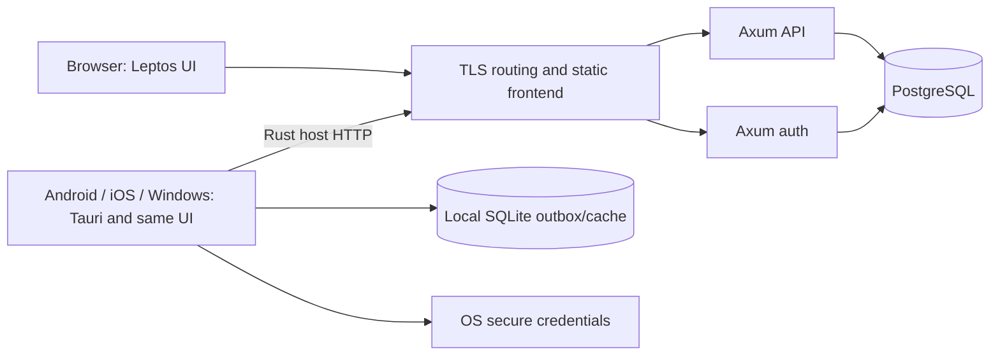

# VSIS Timesheet: Rust rewrite implementation plan

Date: 7 October 2026. Status: proposed implementation plan; no application rewrite or database migration has been performed.

Source inspected: `0fc5f63f03116a3b79153fddbe0ac055001af076`. Repository documentation, an Atlas structural map, current symbols, product contracts, migration SQL, and primary framework documentation inform this plan. Deployed database state and production performance have not been measured.

## 1. Chosen direction

Build a PostgreSQL application with **two small Rust server programs, one shared Rust frontend, and thin native app shells**:

| Element | Decision | Efficiency rationale |
| --- | --- | --- |
| API | Axum + Tokio; one service containing all business domains | Typed asynchronous request handling, shared middleware, and bounded database work without per-domain services. |
| Authentication | Separate Axum service; PostgreSQL-backed sessions | Isolates password hashing and credential privileges. API requests validate sessions directly in PostgreSQL, avoiding an auth-service network call. |
| Frontend | Leptos in client-side rendering mode; Trunk build; plain CSS | One Rust UI for browser and installed apps. Static hosting removes the frontend server, hydration, and Node runtime. |
| Mobile and Windows | Tauri 2; package the same frontend for Android, iOS, and Windows | Share screens and rules; native Rust owns networking, secure credentials, offline storage, and platform integration. |
| Database | One PostgreSQL database and one future migration history | Retain existing application tables, UUIDs, numeric precision, relationships, and important constraints. Remove dual-provider implementation work. |
| Data access | SQLx, PostgreSQL driver only, explicit SQL | A pool, transactions, query checking, and migrations without an ORM or generic repository framework. |
| Deployment | Static reverse proxy + API + auth + PostgreSQL | Small, independently deployable components. Reuse an existing ingress where available. |

The separation is real: API, auth, frontend, and installed applications produce independent artifacts. Auth and API share a database and a small session-validation library, not each other's application code. Their common release initially uses one version and one tested database schema.



Leptos is chosen because this request includes a Rust rewrite of both web and installed applications. Server-rendered Askama HTML would be a strong choice for minimum browser bytes, but would leave a separate offline mobile UI to implement. Leptos adds WebAssembly and generated JavaScript glue; it is not automatically smaller than HTML with a little JavaScript. Validate this tradeoff with the first real screen. The Leptos guide documents static CSR deployment and size optimization; Tauri documents a Leptos/Trunk integration, although its example targets an older Leptos release and must not be copied without checking compatibility. [Leptos CSR](https://book.leptos.dev/deployment/csr.html), [WASM size optimization](https://book.leptos.dev/deployment/binary_size.html), [Tauri integration](https://v2.tauri.app/start/frontend/leptos/).

Axum provides routing and uses the Tower middleware ecosystem. SQLx supplies the selected PostgreSQL pool and driver. These are engineering choices, not claims that these crates beat every alternative in binary size. Pin mutually compatible stable versions and the Rust toolchain after the initial integration build. [Axum](https://docs.rs/axum/latest/axum/), [SQLx](https://docs.rs/sqlx/latest/sqlx/).

The new runtime omits Next.js, React, React Native, PostgREST, Supabase client SDKs, provider-selection branches, Server Actions, and legacy rollback aliases. Keep their source and tests available as reference until acceptance is complete. No Redis, message broker, GraphQL, service mesh, generic plugin system, or custom database migration framework is needed for the initial release.

## 2. Scope and compatibility

Preserve product capabilities, including the current mobile and Windows clients' workflows. A smaller implementation must not achieve its size by silently deleting offline support, reporting scopes, administration, or security checks.

The compatibility target is the released `/api/v1` contract plus observed behavior. Preserve its JSON envelopes, field names, null handling, errors, pagination, partial batch outcomes, and browser/bearer differences at the HTTP boundary. Internally, route both credential paths through shared domain functions. Do not carry forward unused `/api/data`, old auth aliases, or Server Action wrappers into the new codebase.

Keep existing installed clients usable during the replacement-app rollout where contract tests prove compatibility. Cutover invalidates old server-issued sessions and requires sign-in again. Browser users load the new frontend; stale pages using the Supabase SDK must reload and cannot continue using provider sessions. Opaque tokens can occupy existing string-valued token fields only after the current clients pass login, refresh, expiry, export, and retry tests; token parsing or JWT-specific assumptions would require a coordinated client release before cutover. Do not silently change a released contract to simplify a handler.

Repository evidence establishes these important requirements:

| Requirement | Current source to use as the acceptance oracle |
| --- | --- |
| Canonical entry DTOs, conditional classification, batch limits | `packages/contracts/src/timesheets.ts`, `lib/api/v1/contracts.ts` |
| Timesheet orchestration and legacy/new entry transitions | `lib/domain/timesheets.ts`, `tests/timesheet-classification-domain.test.ts` |
| Daily aggregate limit under concurrency | `db/migrations/0015_data_integrity_and_concurrency.sql`, `tests/daily-hours-concurrency.int.test.ts` |
| Permission role, hierarchy role, and resource scope | `lib/roles.ts`, `lib/db/types.ts`, `app/api/v1/_http.ts`, adapter authorization tests |
| Complete web dashboard and reports | `app/dashboard/dashboard-client.tsx`, `app/reports/page.tsx`, `lib/domain/reporting.ts` |
| Mobile capabilities and screen inventory | `mobile/src/navigation/routes.ts`, `mobile/src/navigation/modules.ts` |
| Offline mutation lifecycle and uncertain outcomes | `mobile/src/storage/offline-queue.ts`, `mobile/src/sync/sync-engine.ts`, `lib/idempotency/portable-retry.ts` |
| Native credentials and session races | `lib/auth/password.ts`, `lib/auth/mobile-session-store.ts`, password-recovery integration tests |
| Backup coverage and provider constraints | `lib/db/native/operations.ts`, `scripts/backup-supabase.md`, current native/Supabase migrations |

The snapshot includes classification v2 and the global-reminder banner field. Some migration filenames are later than the plan date; repository presence does not prove deployment. Inventory actual applied migrations before producing the final baseline.

## 3. Minimal codebase layout

Use a new repository or clean sibling checkout for implementation. Do not replace files inside the running application during development.

```text
timesheet-rust/
  Cargo.toml                    workspace, shared dependency versions, profiles
  Cargo.lock
  rust-toolchain.toml
  crates/
    core/                       DTOs, value types, pure rules, capabilities
    db/                         PostgreSQL pool, concrete queries, transactions
    session/                    token hashing and session-to-Actor validation
    client/                     typed operations and browser/native transports
  apps/
    api/                        Axum routes and application orchestration
    auth/                       Axum credential and session lifecycle service
    frontend/                   Leptos screens, small components, CSS, assets
    mobile/                     Tauri host, outbox, cache, platform adapters
  db/
    baseline.sql                schema for an empty installation
    migrations/                 only new, uniquely numbered forward migrations
    bootstrap/                  fixed restore compatibility and verification SQL
  tests/
    fixtures/                   source-derived contracts and expected outcomes
    integration/                real PostgreSQL tests
    e2e/                        browser and native acceptance scenarios
    load/                       repeatable performance workload
  deploy/                       containers/ingress, example config, runbooks
  docs/                         contracts, decisions, operations, benchmark results
```

Eight Cargo packages are sufficient initially. Keep domain files inside the API package instead of creating a crate for every entity. `core` contains related modules rather than an additional contracts/domain/validation package hierarchy.

Dependency direction:

```text
frontend -> client -> core
mobile host -> client/native + core + local SQLite/platform adapters
api -> core + db + session
auth -> core + db + session + password/email libraries
session -> core + db
db -> core
```

`core` must compile for both native and `wasm32-unknown-unknown`. It must not depend on SQLx, Tokio, Axum, Tauri, password libraries, or server secrets. API and auth are the only application components allowed to access PostgreSQL. Native-client credentials never enter the frontend's general-purpose state.

Prefer a route, a small domain function, and an explicit query/transaction. Introduce a trait only at an actual replaceable boundary, such as browser/native transport, clock, or secure storage. Use integration tests for SQL instead of building a large fake database abstraction.

## 4. Dependencies and size control

| Concern | Initial choice | Keep it small by doing this |
| --- | --- | --- |
| Server HTTP | `axum`, required `tower`/`tower-http` layers | Turn off unnecessary defaults. Enable JSON, required protocols, request limits, tracing, and timeouts; no WebSockets unless a real feature needs them. |
| Async runtime | `tokio` | Explicit runtime, I/O, synchronization, timer, and signal features; avoid the convenience `full` feature. |
| PostgreSQL | `sqlx` | PostgreSQL only; one compatible runtime/TLS stack. Enable checked-query support and migrations only where used. No MySQL/SQLite drivers in server binaries. |
| Data types | `serde`, `serde_json`, `uuid`, one date/time library | Reuse one representation of each value. Enable features per target. Keep named-timezone support server-only if required by the verified calendar rules. |
| Errors and logs | `thiserror`, `tracing`, `tracing-subscriber` | One application error mapping and structured logs; no general error/plugin framework. |
| Passwords | RustCrypto `argon2`; compatibility-only `scrypt` and `bcrypt` | Only auth links password operations. Remove legacy verifiers after all remaining accounts have upgraded or reset. |
| Session primitives | Secure OS randomness, `sha2`, encoding and vetted cookie handling | Opaque random tokens need no JWT library or custom signature protocol. Do not implement cryptographic primitives. |
| Email | `lettre` with the selected SMTP/TLS features | Auth only; reuse one configured SMTP transport. |
| Web UI | `leptos`, `leptos_router`, required browser bindings | CSR only; no SSR/hydration stack, UI component suite, or chart framework. |
| Browser transport | Browser Fetch through a small Rust binding | Browser handles TLS/cookies; add cancellation and bounded response parsing. |
| Native HTTP | `reqwest` with minimal features | Reuse one client/pool. Enable only required JSON/stream/TLS features and required enterprise proxy support. |
| Native local data | `rusqlite` in the mobile host | One local database; reuse it for bounded cache and durable outbox. Do not add a second ORM or general sync framework. |
| Installed apps | `tauri` 2 plus needed capabilities | Add only secure storage, file export/share, clipboard, and other demonstrated platform needs. Audit plugin platform support first. |
| CSV | `csv` | Stream parsing and writing. No spreadsheet suite for a CSV product. |
| UI styling/graphs | Plain CSS, system fonts, inline SVG | Small shared primitives and simple report graphics; avoid a CSS runtime, icon font, and visualization framework. |

Do not pick a less mature security or HTTP implementation merely because its direct dependency list is shorter. Measure the transitive graph and release artifacts using `cargo tree -e features`, `cargo tree -d`, and a binary/WASM size report. One duplicated TLS or time stack can matter more than one small utility crate.

Use a throughput-oriented optimized server profile. Use a separate size-oriented WASM profile with stripping, LTO, and measured `wasm-opt` output. Compare optimization levels for real startup and steady-state work; the smallest artifact need not be the fastest. Keep debug information as separate build artifacts for incident analysis.

## 5. API implementation

**Request flow:** bounded body -> parse contract -> resolve current Actor -> check activity/capability/resource scope -> validate rules -> scoped SQL transaction -> map stable response. Apply request ID, deadline, body limit, and structured error handling once in common middleware.

Use one pool per service, not one per request or domain. Start with eight API connections and four auth connections on a small deployment, with a short pool acquisition deadline. These are initial tuning values, not a capacity claim. Account for all replicas and maintenance connections against PostgreSQL's connection limit.

| API area | Implementation | Efficiency and correctness checks |
| --- | --- | --- |
| Config, profile, reference data, dashboard | Preserve existing endpoints and add a bounded dashboard composition only if needed. Return current actor capabilities, settings/version, visible reference data, recent entries and bounded totals. | Budget query count; avoid a request per tile. Reuse references until their version changes. Never cache one user's authorized result for another. |
| Timesheet reads | Filter and project columns in SQL. Preserve released pagination; use stable `(log_date, id)` ordering and offer additive cursor pagination to new clients. | Bounded pages, matching indexes, predictable order during inserts. Do not load full history to compute a page. |
| Entry create/update/delete | Share pure validation, then perform actor-scoped writes and audit in a transaction. Keep legacy fields on legacy edits and prevent classified entries from downgrading. | Positive hours, valid date/backfill, proper ownership, conditional classification, and concurrent daily-cap tests. |
| Copy last/yesterday, duplicate, delete last | Query only the relevant entry/IDs. Duplicate through the normal create validation/transaction. | Never bypass current classification, date, or daily-limit rules. Stable empty-state behavior. |
| Batch edit/delete/duplicate | Validate envelope once; reserve rate limit once; lock affected entities in stable order; preserve per-row successes/errors and existing limits, including 1-500 rows for batch updates. | Use bounded transactions/savepoints or the source-defined per-item behavior; do not accidentally convert partial success into all-or-nothing. No one-request-per-row UI loop. |
| Projects and activities | Narrow create/update/archive/delete functions; return released response shapes. | Preserve nullable S.O./Telegram values, reference protections, reserved project eligibility, and credential-specific permissions. |
| Users, profile, hierarchy, titles | Explicit operations for role axes, activation, manager assignment, self-profile fields, title impact and reclassification. | Recheck current actor/profile state; preserve self-edit restrictions, cycle detection and atomic hierarchy/title updates. |
| Leaves and reminders | Bounded date queries; personal ownership; global publication and per-user dismissal; preserve banner/tile setting. | Unique user/date leave rules, text limits, authorization on administrative views, idempotent completion/dismissal. |
| Reports and export | A common authorized query builder with whitelisted grouping/filter fields, explicit SQL aggregation, and a streaming CSV projection. | Same scope for totals, charts, rows and export; query comparisons before/after rewrite. Never concatenate arbitrary SQL column names from requests. |
| Settings, layouts and branding | Validate and persist compact versioned JSON/settings using existing identifiers. | Validate limits/colors/URLs and permitted layout modules. Bound payloads and retain defaults for older clients. |
| Import and business backup/restore | Preserve existing admin behavior with bounded parsing and explicit transaction boundaries. | Enforce original rate reservations, partial import issues, daily cap, identity/reference resolution, and restore authorization. Distinguish business exports from full database backups. |
| Destructive administrative operations | Separate explicit routes/commands with strongest existing capability checks, audit and transactional deletion/reset. | Reauthentication/confirmation in UI as appropriate; refuse unauthorized actor and wrong scope. Never expose shell or arbitrary SQL execution. |

Keep all of the versioned contract details that are easy to miss: inactive users may read particular profile/session endpoints but cannot write; an invalid explicit bearer must not fall back to cookies; browser and bearer project/user mutation responses currently differ; activity deletion currently has different browser/mobile privileges. Preserve those differences in small boundary adapters until a deliberate versioned product change resolves them.

**Idempotency and concurrent writes**

1. Require a stable mutation key for queued/retried operations, with scope including actor and operation. Hash a canonical request that includes the target resource and relevant payload.
2. Claim the key using a database uniqueness constraint. A duplicate with a different request hash is a conflict. A duplicate with the same hash returns the stored completed result after current authorization is checked.
3. Commit the mutation, effects, audit, and completed receipt together. If the connection fails after commit, the next same-key attempt retrieves the result. Do not mark success before the commit succeeds or recreate the operation under a new key.
4. Keep retained legacy receipts/effects and imported-history semantics while any supported old client can replay. Implement one isolated compatibility reader for their original normalization, request hashes, actor/operation scope, expiry and result encoding. An ambiguous old receipt is not an absent receipt: quarantine it for reconciliation instead of executing again. Include a golden fixture in which the old application commits, loses its response, and Rust receives the retry. Do not replace the existing tables with an empty receipt store during restore. Port only runtime retry compatibility, not the operator migration package.
5. Serialize daily-total changes by user/date. For moving entries and multi-row operations, acquire old and new user/date locks in a deterministic order before writes; retain the database daily-cap constraint/trigger as the final invariant.
6. Lock/validate row versions for offline edits so concurrent changes surface as a conflict. Add a `revision` column if the existing contract lacks one; new clients send it, while legacy-client behavior remains separately tested during its support window.
7. Bound lock waits, return classified transient conflicts, and retry a transaction only when rollback is known. Never blindly retry an uncertain commit.

## 6. Authentication and authorization implementation

Auth owns signup/admission, password login/change/recovery, session issuance/refresh/revocation, and SMTP. API owns business authorization. Both use a small shared `session` library to derive the current Actor from persisted session state and the current profile.

Account creation that includes a password is also an auth-owned transaction: create profile, credential and audit together. Route the existing administrative account-creation method/path to auth, while profile/role updates on the same resource remain API-owned; freeze these exact method/path mappings in the contract table. Reuse the same admin capability checks. API imports may create inactive identity/profile placeholders only where the existing `syncUsers` contract permits it; credential enrollment then occurs through auth with proof of account ownership. Do not give API credential-table writes merely to simplify provisioning, and do not introduce a distributed transaction for it.

Use additive credential/session tables, leaving business profile IDs unchanged. Credentials reference `profiles.id`; sessions contain a user ID, family/device identity, token hashes, expiry, rotation/revocation state, and the profile security version. The API's database role cannot read password hashes or issue credentials. Give it only the session validation columns/view and business grants it needs. After verified credential copy on the target, clear the legacy native `profiles.password_hash` values or exclude that column through explicit grants/views; preserving a second readable copy would defeat the separation. The frozen source backup retains the original. Auth gets narrowly scoped profile reads/creation, audit insertion and credential/session writes; it does not receive general timesheet/report access. A separate migration role owns DDL.

Opaque access and refresh tokens contain at least 32 cryptographically random bytes. Store only their cryptographic hashes. API middleware performs one indexed session/profile lookup and checks token type, expiry, revocation, family/security version, active state and current roles. Never treat a refresh token as an API access token. Database unavailability fails closed. Do not add an authorization cache until its revocation consistency is specified and measured.

| Flow | Implementation |
| --- | --- |
| Browser login/session | Same public origin for frontend, auth and API. Secure HttpOnly host-only cookies; explicit SameSite policy, origin checks and CSRF protection on state changes, including auth lifecycle operations. Frontend JavaScript never handles refresh secrets. |
| Mobile login/session | Tauri host sends requests and stores refresh credentials through OS-protected storage. Access token stays in host memory. Frontend invokes typed operations and receives results, not raw secrets. |
| Password login | Uniform invalid-credential response, equivalent dummy-hash path, database-backed account/IP limits, and a bounded password-work semaphore before `spawn_blocking`. Do not hold a database connection during expensive password verification. |
| New passwords | Argon2id with a reviewed memory/time setting, initially benchmarked around 32 MiB, two iterations and one lane, never below the then-current approved security floor. Rate-limit before hashing. Efficiency means bounded contention, not cheap password hashes. |
| Native imported passwords | Verify both the versioned `scrypt$N$r$p$salt$hash` and legacy `salt:hash` formats. Preserve exact salt encoding and derived-key length; create known-answer fixtures from the current implementation. Upgrade to Argon2id after successful verification. |
| Supabase imported passwords | Preserve user UUIDs and import the existing bcrypt hash from the credential backup. Verify supported prefixes and original byte/length semantics before rehashing. Passwordless/external-provider-only or unsupported credentials use a verified recovery/enrollment flow. Never manufacture passwords or promise all hashes will work untested. |
| Signup | Preserve domain whitelist, active-account admission, role defaults and any applicable verification requirements. Create profile and credential atomically. Do not infer authorization from email domain alone. |
| Refresh | One transaction rotates the refresh hash and access credentials. Serialize refresh in each client; coordinate browser tabs. Known replay revokes the affected family. A lost rotation response can require sign-in again; preserve queued writes throughout. |
| Recovery/change | Single-use hashed token with expiry. Fixed lock ordering across profile, credential and sessions. Password change/reset bumps security state and revokes applicable sessions atomically. Concurrent reuse must fail. |
| Logout/revoke | Revoke the relevant family/session in PostgreSQL; clear client secrets. Other-session revocation and admin deactivation take effect on the next API validation. Handle pending offline edits before clearing local data. |

Token lifetimes remain configurable and initially match the released policy where compatibility requires it. Choose a short access lifetime, an idle refresh limit, and an absolute family limit; test all three independently rather than allowing indefinite sliding renewal.

For protected mutations, adopt serialized authorization: recheck current session/profile state inside the write transaction and hold the relevant locks until commit. Disable/demotion/revocation acquires conflicting locks. A write ordered before revocation can finish; a write ordered after it must fail. Use one documented lock order across affected profiles, credentials, sessions and business resources, sorting multiple IDs and avoiding lock upgrades. Ordinary reads use current state at their authorization check. Test the ordering with barriers between concurrent transactions, and bound lock waits so a stalled write cannot indefinitely block revocation.

Keep `permission_role` (`admin`, `pm`, `co`, `user`) independent of `hierarchy_role` (`manager`, `team_lead`, `engineer`, `user`). Preserve the actual superadmin mechanism from current source. Central capability functions improve consistency, but every query must also constrain ownership/team/report scope. Hiding a UI control is not enforcement.

Use application-enforced scoped SQL with a restricted, non-owner database role as the canonical new authorization boundary, following the native implementation's model. Do not carry Supabase `auth.uid()` policies into plain PostgreSQL and assume they work. Remove/replace provider-dependent policies and functions only in the rehearsed target bootstrap, after equivalent authorization tests exist. PostgreSQL grants still isolate credentials, sessions, business operations and operator privileges.

Supabase documents bcrypt storage, and OWASP provides the password-hashing guidance to check during implementation. [Supabase password storage](https://supabase.com/docs/guides/auth/password-security), [OWASP password hashing](https://cheatsheetseries.owasp.org/cheatsheets/Password_Storage_Cheat_Sheet.html).

## 7. Shared frontend implementation

Build one responsive Leptos application. Keep page state local; use a small shared context only for actor/session status, workspace, reference data and theme. Use keyed lists and derived signals for totals/selection. Fetch when a screen needs data, cancel obsolete requests, debounce searches, and invalidate only affected resources after a successful write.

Use native inputs, buttons, tables, dialogs and accessible labels. Build approximately a dozen small reusable primitives: field/error, button, dialog, toast, date controls, filter bar, table/pagination, selection toolbar, empty state, loading state, capability gate and layout tile. Avoid a generic form builder or dashboard engine.

| Screen/element | Efficient implementation and required behavior |
| --- | --- |
| Sign in, signup, recovery, activation pending | Shared forms and structured validation. Distinguish signed-in from active. Recovery links use approved origins and never leak tokens into logs or third-party requests. |
| Dashboard/navigation | Reproduce capability-based modules and configurable layout, including essential navigation items. One bounded initial data composition; lazy-load less common admin/report content where the chosen build supports it. |
| Log time | One shared form for web/mobile. Project/Support/Internal choices drive valid activities and conditional fields. Preserve legacy-edit handling, local calendar behavior, backfill, daily remaining hours and description limits. |
| Suggestions and copy | Port smart-hours, recent work and last/yesterday functions into `core`. Smart-hours must retain the existing weekday sample/consensus and tie behavior. Suggestions never override explicit user input. |
| Entry list/edit/bulk operations | Paginated, date-grouped entries; inline edit, duplicate/delete, multi-select and bulk edit. Optimistically render safe local states but reconcile server validation; mark pending mobile writes clearly. |
| Calendar and totals | Date-only calendar computations and SQL-backed daily/month totals. Treat `log_date` as a calendar date, not midnight converted through UTC. Test month edges, browser timezone changes and backfill boundaries. |
| Reports | Preserve date presets, custom ranges, project/user/team filters, grouping, comparisons and CSV. Use accessible tables plus simple SVG/bar/line graphics from already aggregated data. Do not bring raw history to the browser for grouping. |
| Leaves/reminders | Shared personal and administrative forms; done/dismiss states; global reminder banner versus tile. Announce errors and state changes accessibly. |
| Profile/security | Department/title editing, applicable hierarchy restrictions, password change, sessions/revoke, workspace/theme preferences. Reuse current capability policy. |
| Project/activity administration | Bounded searchable lists and explicit forms for names, activity status, S.O./Telegram values and project eligibility. Validate referenced-item deletion failures. |
| User/team/title administration | Role axes, activation, manager/team hierarchy, title impact/reclassification and protected operations. Server remains authoritative for cycles and permission changes. |
| Settings/branding/layout | Compact versioned settings and CSS variables; preserve web/mobile layouts and banner preference. Reject malformed values and unknown module identifiers. |
| Telegram helpers | Pure shared formatter, clipboard/share integration. Preserve `/log` and yesterday/date variants, unpadded date, trimmed hours and one-line description. No new Telegram bot service is implied. |
| CSV import, business export/restore, resets | Progress/partial-result summaries, bounded file selection and explicit destructive controls. These screens never receive database passwords or invoke `pg_restore`. |

Rust `core` should represent hours internally as integer hundredths, with checked parsing and exact decimal serialization matching existing wire contracts. A minute-only representation would lose valid hundredth-hour values. Retain PostgreSQL `NUMERIC` storage; use exact scaled query conversions rather than binary floating-point arithmetic for daily limits and totals.

Preserve the existing local-date/backfill policy by porting its observable tests, with explicit date-only values and one defined server validation path. Do not replace date fields with timestamps or silently introduce a different timezone policy during the rewrite.

Serve versioned, compressed static assets with long immutable caching and the HTML entry document with revalidation. Configure deep-link fallback without returning HTML for missing API routes. Avoid caching authenticated API responses in a service worker; initial browser offline writes are outside the current mobile-offline parity scope.

## 8. Mobile and Windows implementation

Tauri packages the same compiled UI; it does not open an arbitrary remote website. Use a narrow platform adapter for HTTP, secure storage, cache/outbox, clipboard, file export/share and approved external links. Business rules and screens stay in Rust shared code. Small Kotlin/Swift/platform bindings may still be needed where the mobile plugin ecosystem does not cover a required OS feature. [Tauri mobile plugins](https://v2.tauri.app/develop/plugins/develop-mobile/).

The WebView is a distinct trust boundary. Grant only required Tauri capabilities, deny arbitrary shell/filesystem/network commands, restrict navigation, and apply a restrictive CSP that permits the chosen WASM build. A typed native HTTP command accepts known operations for the selected workspace; it must not attach credentials to arbitrary URLs or follow cross-origin redirects with secrets. [Tauri capabilities](https://v2.tauri.app/security/capabilities/).

Use Android Keystore-backed encryption, iOS Keychain, and Windows Credential Manager/DPAPI through a verified plugin or small adapter. A plain Tauri store file is not secure credential storage. Verify platform coverage in the first slice before relying on one plugin across all targets.

Local SQLite has two bounded responsibilities: cached read models and a durable mutation outbox. Cache and queue namespaces include canonical workspace origin plus actor UUID. Switching accounts/workspaces never exposes another namespace or replays its writes. Use application sandbox/data protection, define retention and logout handling, and document whether local business data requires additional at-rest encryption.

Outbox records contain the original mutation UUID, target/operation, canonical payload, actor/workspace, creation time, attempts, expected revision and explicit state. Persist before announcing the edit as queued. Retain FIFO order per actor, batch network work conservatively, and never coalesce an operation that may have reached the server.

| Event | Required transition |
| --- | --- |
| Offline create/edit/delete | Save durable intent and optimistic view; distinguish it from a server-confirmed record. |
| Reconnect/resume | Refresh credentials once, verify actor/workspace, then replay sequentially using the original idempotency key. |
| Network/5xx failure | Bounded exponential backoff with jitter; stop the current flush on network loss; retain original creation time. |
| 401 or revoked session | Pause sync and request sign-in; preserve entries. Never fall back to another account. |
| Validation/authorization failure | Show a repairable issue; do not continuously retry a permanent failure. |
| Revision conflict | Show current server data and the local intent; require a reviewed merge/replacement. |
| Commit outcome unknown | Recover through the same key and retained receipt. If unresolved, manual review; no new automatic mutation key. |
| Ten attempts or age at least 90 days | Preserve current manual-review behavior, including the exact 90-day boundary. Manual retry does not reset the age/origin. |
| Old unclassified queued create | Preserve it for review and classification. A replacement gets a fresh key only after the original's uncertain outcome is resolved. |
| App killed during save/flush | Recover durable state on launch; transactionally reconcile confirmed result and cache before removing outbox intent. |

Do not promise continuous background synchronization on iOS/Android. Foreground, resume and connectivity-triggered sync are the guaranteed paths; OS background opportunities are optional optimizations.

For replacement of installed React Native apps, preserve app identifiers and signing identities where possible. First drain old queues against the old server. If a queue remains, an explicit one-time handoff must retain its original key, scope and uncertainty state, using retained server receipts for reconciliation. Inspect the actual old storage location/format on each platform; shared application identity alone does not prove data is accessible. Do not instruct users to uninstall or clear data to upgrade. This is a small client-state compatibility task, separate from database backup/restore.

Use a compatibility-first rollout: designate and test one supported client revision per released platform before server cutover. That revision must authenticate against Rust and replay its existing queue safely. If the currently installed client fails this gate, publish a minimal compatible React Native bridge update before switching the server; do not improvise a token or queue conversion during cutover. Verify app identity, signing continuity and queue accessibility on physical devices. Unsupported versions must stop starting new writes while retaining a recovery/export path for pending work. Replace the compatible client with Tauri after its update/handoff tests pass. Do not delete receipt compatibility or legacy password verification merely because the new clients have shipped.

## 9. Database implementation and backup/restore migration

**Keep database migration as a maintenance-window backup/restore operation.** There is no live synchronization, dual writing, merge engine, CDC, account remapping, or reuse of the large cross-provider operator package. Preserve identifiers and data semantics; perform code cleanup independently of schema cleanup.

The qualification is that a Supabase database is PostgreSQL plus provider-specific objects. A raw dump of its managed schemas is not automatically a portable plain-PostgreSQL application backup. The official restoration guide targets a compatible Supabase installation and lists configuration/storage exclusions. Our plain-PostgreSQL target therefore needs a small, rehearsed compatibility bootstrap. [Supabase restore guidance](https://supabase.com/docs/guides/self-hosting/restore-from-platform).

**Canonical database**

| Data group | Implementation decision |
| --- | --- |
| Profiles, projects, activity types, timesheets | Preserve table/column identifiers and UUIDs. Retain role synchronization and classification constraints that still have product meaning. |
| Leaves, reminders, global reminders/dismissals | Preserve relationships, unique constraints, completion state and banner preference. |
| Titles, whitelist, app settings, layouts, branding | Include in the schema and full backup. Treat them as product data, not defaults that can be regenerated freely. |
| Audit and idempotency history | Preserve records needed for accountability and supported retry recovery. Retention must outlast the supported queue/reconciliation window. |
| Rate limits | Preserve applicable reservations during cutover or explicitly freeze operations that would otherwise gain a fresh allowance. Cleanup must not delete active reservations. |
| Credentials and sessions | Add the Rust-owned credential/session tables. Copy legacy password hashes with unchanged user IDs; revoke old sessions/reset tokens at cutover rather than replaying old provider credentials. |
| New mutable-row revision | Add a small revision counter where needed for new-client conflict detection. Keep legacy write semantics isolated during compatibility support. |
| Retired provider/migration artifacts | Archive with the original backup. Remove runtime dependence first; drop tables/functions only after their consumers and recovery obligations are verified absent. |

Use explicit column lists and parameterized queries. For reads, return exactly the columns the screen/DTO needs. For aggregates, filter by actor scope and date before grouping. Reuse existing indexes first, then inspect `EXPLAIN (ANALYZE, BUFFERS)` against representative data. Likely access paths are user/date/id, project/date, manager/profile, active reference data, and session-token hash; add indexes only after inspecting the existing schema and plans. Extra indexes impose write and vacuum cost.

Select the target PostgreSQL major version from the deployed source preflight, using the same major for cutover where possible. Do not combine the rewrite with a database downgrade or an unrelated major upgrade. Record extensions, collations, timezone, roles, constraints, triggers and actual applied migrations. Pin the database image by a tested version/digest.

**One exact supported schema bridge**

Define one supported source schema manifest for the actual deployment, including expected columns, constraints, functions and migration identifiers. Verify that manifest before export and again after restore. If the source is behind, advance it through the existing approved migration workflow before the migration window; do not guess compatibility from filenames.

For an empty new installation, run `baseline.sql` then the Rust-owned forward migrations. For an existing restored installation, verify the canonical schema requirements and run only the explicit bridge/forward migrations. Never execute the empty-database baseline over restored tables. Record successful baseline verification separately from migration execution.

Do not feed the old native migration directory directly into SQLx. The inspected history includes two files starting with `0017`, and existing migration bookkeeping has its own semantics. Archive that history unchanged; start a uniquely numbered Rust-owned sequence only after the schema bridge has succeeded. Run migrations as a release job with a migration lock, not opportunistically when each API replica starts.

**Native PostgreSQL source**

1. Preflight schema, row counts, constraints, version and backup destination.
2. Enter maintenance: stop application writers, scheduled jobs, imports and schema changes; let in-flight writes settle.
3. Produce a consistent PostgreSQL custom-format dump, with roles/grants/environment captured separately where required. Protect credential-containing backups.
4. Restore into an empty isolated target using a compatible PostgreSQL toolchain, explicit ownership/grant handling, and fail-on-error settings.
5. Verify the supported source schema; apply the single Rust bridge to add credentials/session state and other necessary additive fields.
6. Verify business data, credential samples, constraints and retry history before accepting traffic.

`pg_dump` takes a consistent database snapshot. Custom-format output supports controlled restoration with `pg_restore`; it does not back up server configuration or all cluster-global objects. [PostgreSQL pg_dump](https://www.postgresql.org/docs/current/app-pgdump.html).

**Supabase source**

1. Inspect the actual deployed schema and produce a canonical plain-PostgreSQL baseline with equivalent business columns, defaults, constraints and triggers. Resolve provider-owned foreign keys/functions/policies explicitly in this baseline; do not broadly disable constraints and call the result valid.
2. Back up the application tables using PostgreSQL-compatible data export and explicit columns. Include all business/configuration/audit/retry tables from the manifest, not just a handpicked list of obvious timesheet tables.
3. Include a companion credential export keyed by `auth.users.id`, with the password hash and relevant enrollment/verification state. A fixed SQL/COPY export and restore is sufficient; no application-level account matching is needed because UUIDs remain unchanged.
4. Restore business data into the canonical baseline, then load credential records and apply the Rust bootstrap. Check every cross-table reference and provider-derived rule. Preserve an untouched full source backup for recovery and audit.
5. Recreate only required runtime grants. Do not restore reserved Supabase roles, managed triggers, service-role assumptions or auth session tokens into the new runtime.
6. Reauthenticate clients, configure SMTP/origins/secrets separately, and confirm whether any file objects exist outside PostgreSQL. Copy required external objects separately; database metadata cannot restore their bytes.

This is still a fixed export/restore runbook, but it is not literally an unmodified full Supabase SQL dump restored into empty vanilla PostgreSQL. Rehearse the exact path early. If a deployment actually requires a zero-adaptation full restore, its target must remain source-compatible; do not promise that and plain PostgreSQL simultaneously.

The existing admin JSON business backup is insufficient for this migration: its native implementation exports projects, activity types, timesheets, leaves and reminders, with name/email references. It does not provide the complete credential/profile/hierarchy/settings/audit/session state of a database backup. Preserve that feature for its existing product purpose, but use full database tooling for cutover.

The repository's Supabase backup script exports several files sequentially without one shared snapshot, and its documentation says external storage bytes and platform configuration are excluded. For the final export, keep both writers and DDL stopped throughout every file export, or use a deliberately coordinated snapshot. A checksum proves file integrity, not a successful restore.

**Restore acceptance**

Validate every manifest table's count; UUID/key preservation; foreign keys; no duplicate identities; minimum/maximum dates; exact hour totals by user/date/project/classification; hierarchy/title relationships; settings/layout/reminder state; audit and idempotency receipt counts; credential verification fixtures; and role-scoped report results. Use deterministic ordered checksums where practical, keeping secrets out of reports. Run `ANALYZE` and representative query plans after loading data. A small sample of recent timesheets alone is not enough.

**Cutover and rollback**

Keep the source database frozen and recoverable. Put the restored target through read-only smoke tests first. Publish the compatible auth/API/frontend artifacts, verify client versions and queue recovery, then open writes on the target and switch traffic once. Never allow both databases to accept independent writes.

Before target writes begin, rollback is a traffic/configuration switch to the frozen source. After the target accepts writes, that source snapshot is stale: stop target writes, preserve/export the delta and reconcile it, or repair forward. Do not advertise an instant lossless switch back to the old snapshot. Retain the target database and mobile outboxes during any failure.

## 10. Deployment and operations

Use the existing ingress if available; otherwise Caddy is a practical initial choice for static assets, TLS and routing. Route the observed `/api/v1/auth/*` auth-lifecycle endpoints to auth, other `/api/v1/*` business endpoints to API, and application paths to static assets. Any profile/business paths nested under auth must be mapped according to the frozen contract rather than a blind prefix assumption.

Ship separate non-root API/auth images from a multi-stage build, with no Rust compiler or package manager in runtime images. A small glibc-based runtime is the default; only switch libc/static linking after compatibility and throughput measurements. Give auth and API separate database credentials, memory/concurrency limits and health probes. Keep PostgreSQL private.

Configuration should be explicit and validated at startup: service addresses, database pool limits/timeouts, canonical public origin, trusted proxies, SMTP, token/password policy and required feature flags. Preserve server-owned classification rollout behavior until the deployed client/schema policy is aligned. Do not expose server settings merely because a frontend build uses Rust.

Use structured request logs with request ID, route, status, duration, actor ID where justified and a sanitized error code. Never log passwords, tokens, database URLs, arbitrary request bodies or full exported records. Measure latency histograms, active requests, pool wait, SQL time, password queue depth, error rate and receipt conflicts. Reuse an existing metrics collector; a new observability platform is not a rewrite prerequisite.

Preserve scheduled cleanup and existing operational behavior. Initially expose a small authenticated/administrative maintenance command and run it with the deployment scheduler. Use database locking so concurrent schedules do not duplicate work. Clean expired sessions/reset tokens/rate-limit records and eligible receipts in bounded batches. Do not create a general job-queue service for these tasks.

SMTP failures must have explicit outcomes and safe retry behavior. Email submission is external to database transactions; a small PostgreSQL outbox is justified only where durable delivery/retry is a requirement. If added, one scheduled sender with bounded retry is sufficient. Never claim an email was sent merely because a token row was inserted.

## 11. Efficiency targets and measurement

These are proposed engineering budgets, not observed performance results. The first milestone measures the current production-style build against the same dataset, PostgreSQL placement, machine size, client devices and workload. Record both warm and cold behavior and the whole deployment cost, including the additional auth process.

| Metric | Initial target | How to assess it |
| --- | --- | --- |
| Server memory | Combined API+auth idle RSS at most 100 MiB; ordinary loaded RSS at most 256 MiB, with explicit allowance for the configured password-work limit | Measure both processes, allocator behavior and peak hashing load. Report PostgreSQL/ingress separately and total stack memory as well. |
| Server work | Aim for at least 40% lower CPU time per fixed request workload and lower memory than the current equivalent deployment | Same database, request mix, response correctness and concurrency; no comparison between a warm Rust server and a cold Next.js dev server. |
| Interactive API | p95 at most 150 ms for ordinary paginated reads/writes at the agreed baseline load; no regression on existing critical flows | Proposed starting workload: 50 active clients, mixed reads/writes, 100 requests/s if realistic. Report latency, throughput, errors and pool waits together. Exclude deliberate password-hash latency. |
| Reporting | Common bounded report p95 at most 500 ms on representative data; exports stream without memory proportional to row count | Test approximately one million entries plus a smaller real-size fixture; inspect SQL plans and peak RSS. Narrow ranges and broad admin exports are separate workloads. |
| Dashboard network/SQL | One principal authenticated bootstrap request; at most six database queries including identity for the normal landing screen | Count actual queries and payload bytes; reference-cache hits and misses are separate cases. Do not hide unbounded aggregates inside one query. |
| Frontend cold payload | Target at most 1 MiB compressed total initial HTML/CSS/JS/WASM, excluding user exports | Production build with actual entry/list/navigation UI. Track raw WASM, compressed size and compilation/startup, not gzip alone. |
| UI responsiveness | INP at most 200 ms for normal interactions on the selected midrange device; keyboard/screen-reader flows remain usable | Profile form changes, list selection and reports. If the initial bundle is excessive, defer infrequent features or restructure modules before adding framework layers. |
| Installed apps | Aim for at least 30% smaller comparable installed/download footprint than the current client; cold usable startup around two seconds on the reference Android device | Same architecture, signing mode and asset set. Measure iOS and Windows separately, including WebView/process memory; platform runtime availability changes package comparisons. |
| Offline efficiency | No continuous idle polling; bounded queue/cache; one flush per lifecycle trigger and controlled backoff | Battery/network traces and kill/resume tests on physical devices. |
| Build/developer cost | Record clean/incremental native, WASM and platform build times and dependency counts | Runtime improvements do not excuse an unnecessarily fragmented workspace or uncontrolled compile times. |
| Codebase size | Track handwritten production Rust/CSS/native glue separately from tests, generated platform code and SQL history | Target fewer duplicate rules and adapters; do not impose a line-count ceiling that removes safeguards or features. |

Treat a missed budget as evidence to investigate before rollout, not permission to change the benchmark or drop behavior. Set final capacity targets from actual usage in milestone 0. Avoid speculative caching, parallel query fan-out, lock-free code, custom allocators, or unsafe Rust until profiling identifies a relevant bottleneck.

## 12. Implementation order and acceptance gates

Build vertical slices so each milestone proves a useful workflow. One implementation owner should own shared contracts and database/auth transactions at a time; independent UI work can follow a frozen contract. Keep source-derived fixtures available throughout.

| Milestone | Concrete work and deliverables | Depends on / exit gate |
| --- | --- | --- |
| 0. Freeze behavior and establish measurements | Enumerate every route, screen, role/capability, report filter/grouping, table and scheduled operation. Capture safe golden DTO/error/CSV/Telegram fixtures. Record deployed schema and released client revisions. Benchmark current server/web/mobile. | Complete parity matrix and supported-source manifest; no unresolved unknown about which database/client versions will be migrated. |
| 1. Prove the small stack | Create the eight-package workspace and pinned toolchain. Build static Leptos login/entry/list UI, Axum JSON endpoint, SQLx query and Tauri packages. Verify secure storage, file export, keyboard/safe areas and WASM CSP on real platforms. | Browser plus Android/iOS/Windows smoke builds. Record bundle/package/startup size. Revisit stack only if this actual slice fails the size/platform requirements. |
| 2. Establish database and restore path | Create the canonical baseline, exact source preflight, fixed bridge, roles and new migration history. Restore a representative backup into an isolated database. Implement typed/scoped queries and transaction helpers. | Every manifest table reconciles; unsupported source schemas fail early; no duplicate migration-version assumptions; fresh install and restored install reach equivalent schema. |
| 3. Complete identity and access | Implement native/Supabase credential compatibility, new password policy, signup, login, refresh, recovery, revoke and current Actor/capability checks. Implement origin/CSRF and rate limits. | Auth tests, real PostgreSQL reset/refresh/revocation races, permission matrix and old-client auth contract pass. API never reads credentials. |
| 4. Ship the first complete business slice in staging | Entry creation, reading, editing, delete, copy, classification, fixed-point hours, backfill, daily cap, audit and idempotency. Shared UI works through API in browser and Tauri. | Golden contract parity; negative authorization/date/classification tests; concurrent daily cap and old-commit/new-retry recovery pass. |
| 5. Prove offline and upgrades | Durable SQLite cache/outbox, same-key replay, retry/manual-review/conflict states, account/workspace isolation and old-client queue handoff. Verify signed replacement-app update path. | Airplane mode, kill during commit, lost response, token expiry, 90-day boundary and cross-device conflict pass. Identify the exact compatible client revision required before cutover. |
| 6. Complete product parity | Reports/CSV, calendars, leaves/reminders/banner, projects/activities, users/hierarchy/titles, profile/security, settings/branding/layout, Telegram, imports/business backup/restore and protected reset operations. | Every row in the milestone-0 screen/route/permission matrix is implemented and checked; aggregates and exports match source expectations. |
| 7. Harden and optimize the settled implementation | CI, release images/config, bounded maintenance, telemetry, query plans, dependency/size audit and realistic load tests. Improve measured bottlenecks only. | Security/concurrency tests and performance budgets pass; degraded DB/SMTP/network behavior is tested; artifacts are reproducible. |
| 8. Rehearse the exact release | Restore the selected source schema/backup, apply bridge, install signed compatible clients, switch staging traffic and simulate rollback both before and after target writes. Time every operator step. | Written rehearsal evidence, known downtime, backup/restore validation and queue recovery. No unsupported client/token/schema assumption remains. |
| 9. Cut over and simplify | Execute the rehearsed freeze/export/restore/verify/switch sequence. Monitor actual latency, errors, auth and retry outcomes. Remove old runtime dependencies after the agreed recovery/client window. | Accepted production workflows and measured efficiency improvement. Remove legacy hash/receipt/client adapters only when their remaining consumers are accounted for. |

Milestones 0-5 form the critical risk path. Do not spend most of the rewrite on administration screens before proving restore, authentication, the daily cap and offline replay. The user interface and database remain complete product components; intermediate milestones are staging increments, not permission to replace production with a partial application.

## 13. Verification matrix

Use the current tests as behavioral evidence, not files to translate mechanically. Share table-driven fixtures between Rust unit tests, API contract tests and client tests where they verify the same contract. Keep TypeScript/Playwright tooling as development-only test dependencies if it reduces test effort; it is not part of the runtime architecture.

| Layer | Required verification |
| --- | --- |
| Portable core | Hours parsing/rounding and sums, classification branches and legacy transitions, date/backfill boundaries, smart-hours, capability matrix and Telegram golden output; include invalid inputs. |
| API contract | Status/envelope/error/null shapes, cookie versus bearer cases, profile inactivity policy, pagination, per-row batch results, body limits, imports and exports. Test actual supported old clients as well as new Rust DTOs. |
| Database authorization | Users cannot read/write others' data; reporting scopes match; both role axes and superadmin exceptions are exercised; DB grants deny credential reads from API. |
| Transaction invariants | Concurrent creates/edits crossing 24 hours; date moves; overlapping batches; same/different-key retries; commit-response loss; stale/ambiguous old receipts; controlled deadlock/timeout handling. |
| Auth concurrency | Parallel refresh, replay, password-change/reset race, expired/single-use recovery token, disable/demotion versus active mutation, logout/revoke and old credential fixtures. |
| Browser | Every primary role's normal and rejected workflow, keyboard and screen-reader checks, responsive layout, local-date boundary, reload/deep links, CSRF and cache isolation. |
| Installed apps | Signed builds, OS secure storage, workspace switching, airplane mode, kill/restart, queue conflicts, original-key preservation, package upgrade/handoff, file export/share and lifecycle behavior. |
| Restore/operations | Fresh install, native restore, actual Supabase restore if that is the source, supported-schema refusal, exact data reconciliation, migration locking, maintenance idempotency and rollback limitations. |
| Performance | Production artifacts; same-hardware comparison; response equivalence; representative dataset; latency/CPU/RSS/query/payload/mobile measurements together. |

CI runs formatting, Clippy, core tests, native builds, the WASM build, PostgreSQL integration tests and browser acceptance. Platform jobs build Android, iOS on macOS/Xcode, and Windows with appropriate signing managed outside the repository. Native UI automation capabilities differ by platform: use supported automation plus explicit device acceptance where full WebDriver coverage is unavailable, and report that gap honestly.

Use independent review at the concrete risk milestones: credential/session design, scoped SQL and transaction protocol, restore bridge, and final changes to those surfaces. Review the changed protocol and evidence rather than repeatedly reviewing the entire unchanged repository.

## 14. Decisions and review record

| ID | Decision or resolved concern | Evidence needed before completion |
| --- | --- | --- |
| D1 | One PostgreSQL provider; preserve business schema semantics and IDs | Exact source manifest and reconciled restore. |
| D2 | Separate API/auth processes and static shared Rust UI | Combined resource measurements and independent artifact/deploy checks. |
| D3 | Leptos CSR + Tauri reuse outweighs minimum HTML payload for this Rust rewrite | Working-screen bundle/startup and signed platform spike. |
| D4 | Explicit SQLx queries; concrete modules rather than generic repositories | Query/feature audit, checked SQL and scoped integration tests. |
| D5 | Opaque sessions, current-profile lookup, serialized mutation authorization | Supported-client auth tests and revocation/disable race tests. |
| R1 | Old receipts need a format/hash-aware reader; preservation alone is insufficient | Old commit + lost response + Rust retry fixture; ambiguous outcome refusal. |
| R2 | Revocation versus writes has an explicit transaction ordering | Barrier-controlled mutation/revoke/demotion tests. |
| R3 | Restored schemas enter the new history through one verified bridge | Same canonical schema from fresh and restored installs; unknown schema rejected. |
| R4 | Client compatibility must be established before server cutover | Named signed client revisions, real update/queue-access tests, bridge release if required. |

An independent architecture review examined the decision packet and raised R1-R4; this plan incorporates those corrections. A bounded closure review found those four protocol concerns resolved, with no material unresolved defect in the reviewed corrections or related auth boundary. Both reviews were packet-based; the reviewer could not independently inspect source because its shell failed to start. Root source inspection is recorded above. No runtime performance claim or production restore validation has been established by writing this document.

Completion means all existing required workflows operate through the Rust system, the chosen backup/restore procedure has been proven, installed clients retain their pending work, and measured resource use improves against the recorded baseline. The implementation is minimal when it eliminates duplicated rules and unnecessary infrastructure while keeping those guarantees.

